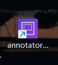
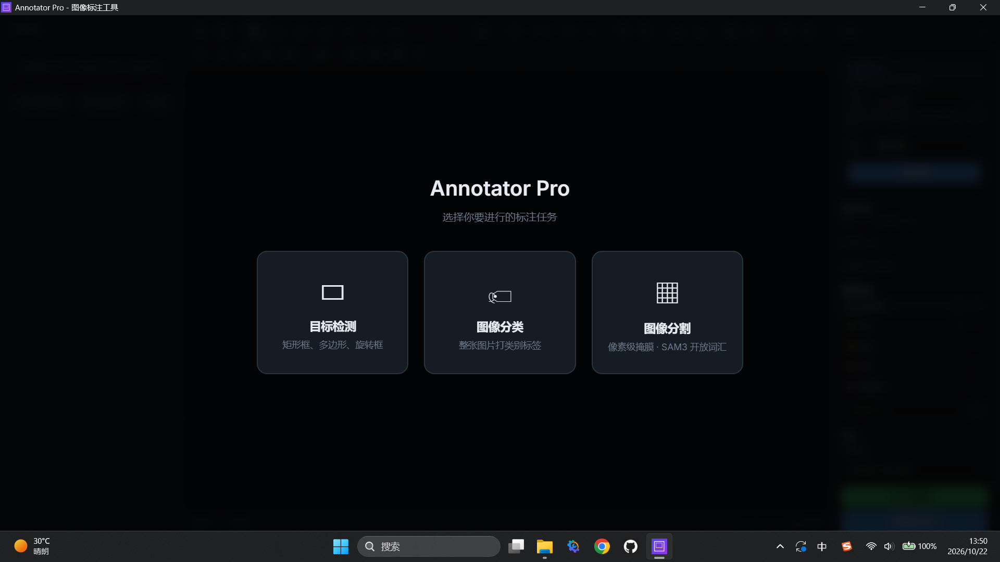
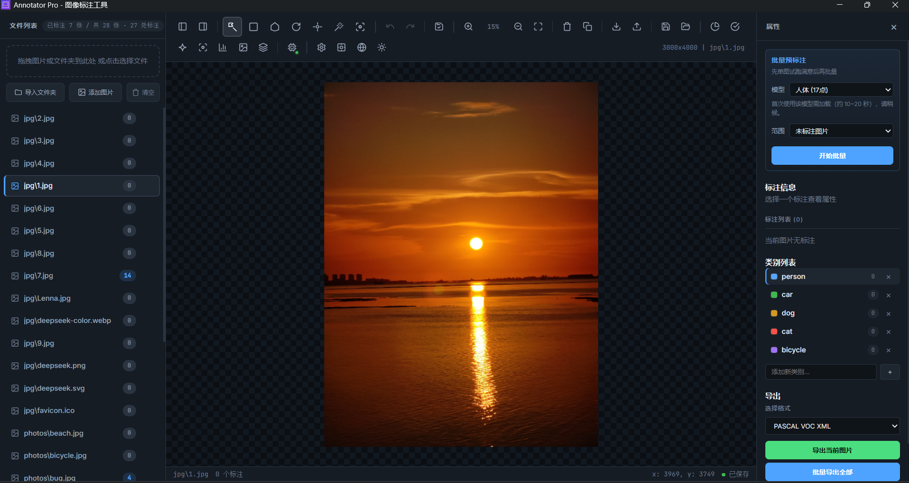
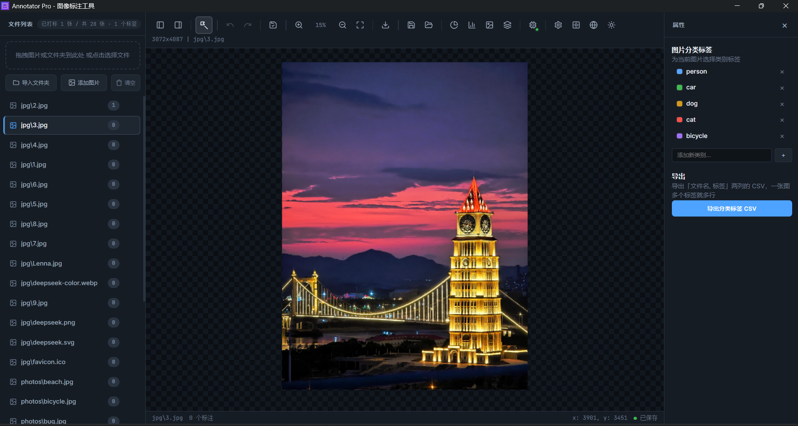
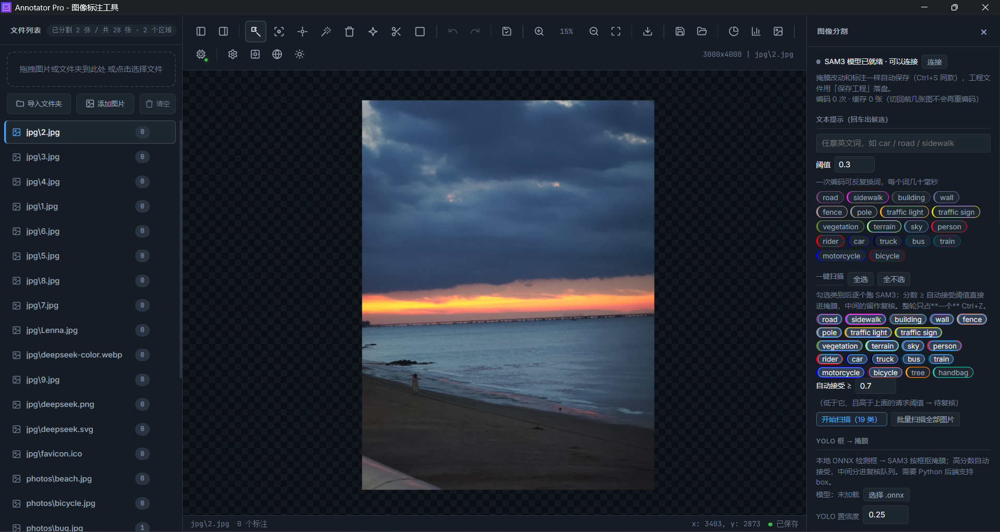

<div align="center">


</div>

# Annotator Pro

本地运行的图像标注工具，面向 **目标检测 / 图像分类 / 图像分割** 三类任务。

桌面端是 **Tauri 2 + Svelte 5**，AI 推理走本地 Python 服务（**SAM3 / YOLO**），全程离线、不依赖任何云服务。

**在线展示页**：[https://student-he-1.github.io/annotator-pro/](https://student-he-1.github.io/annotator-pro/)

- 标注数据以工程文件（`.annotator`）保存，支持自动保存与撤销/重做
- 图片 `name` 支持子目录（如 `jpg/9.jpg`），导出文件名自动只用 basename，不会凭空建目录
- 三种模式的标注数据彼此独立，互不污染

---

## 界面展示

<p align="center">
  
</p>

<p align="center"><strong>Annotator Pro</strong> · 本地 AI 图像标注工具</p>

### 启动页

选择目标检测、图像分类或图像分割后进入对应工作区。



### 目标检测

矩形 / 多边形 / 旋转框 / 关键点标注；右侧可调批量预标注、类别与导出格式。



### 图像分类

整图多标签分类，支持批量打标与分类 CSV 导出。



### 图像分割

SAM3 文本提示 / 全类扫描 / 画笔橡皮 / 区域复核；右侧显示模型状态与分割类别。



---
## 三种工作模式

| 模式 | 能力 | 导出 |
|---|---|---|
| **目标检测** | 矩形 / 多边形 / 旋转框 / 关键点（骨架模板：人体 17、人脸 68、手部 21、自定义）；SAM3 点·框·文本提示；YOLO onnx 预标注；魔术棒；批量操作 | VOC / YOLO（含 Pose）/ COCO / LabelMe / CreateML / PNG / JPG / U-Net Mask |
| **图像分类** | 整图打多标签、批量打标、按标签筛选 | 分类 CSV |
| **图像分割** | SAM3 像素级掩膜：文本/框提示、一键全类扫描、画笔/橡皮/负点修正、区域合并与孤岛清理、区域拆分、小目标过滤、整目录批量扫描 | COCO 实例 JSON / YOLO 分割 TXT / Cityscapes 语义 PNG / 实例掩膜 PNG / U-Net PNG |

## 功能亮点

### 目标检测
- 矩形、多边形、旋转框、关键点四类标注；关键点按**骨架模板**管理，导出时用骨架类别
- 关键点不冒充目标类别：不画类别角标、不进类别统计；VOC/YOLO 这类没有关键点概念的格式会**明确提示**已跳过
- 关键点骨架模板随工程走：被标注引用到的自定义模板会写进 `.annotator`，换机器打开自动合并
- YOLO Pose 导出：bbox 由关键点推导并外扩 5%，未标点补 `0 0 0`；`classes.txt` 与行索引保持一致
- 魔术棒（按图片缓存整图数据，大图连点不卡）
- 批量改类别 / 批量删除 / 批量打标签，均可整体 `Ctrl+Z`
- 批量复制当前图标注到指定图片范围：自动跳过尺寸不一致、已有标注的图，整批只占一个 `Ctrl+Z`
- 数据集划分三种模式通用：检测按标注、分类按标签、分割按掩膜区域取数
- 图片质量筛查（过暗、重复图等）与标注质量校验
- YOLO 框 → SAM3 掩膜：本地 ONNX 检测框直接交给 SAM3 抠掩膜，高置信自动接受、中间分进复核队列

### 图像分类
- 一张图可打多个标签；标签表与检测类别共用
- 批量打标 / 批量删标，状态栏正确显示「未保存 → 已保存」

### 图像分割（SAM3 像素级）
- **开放词汇文本提示**：输入任意英文词（或中文，内置驾驶场景词表），ENTER 出候选
- **一键全类扫描**：勾选类别后逐词跑 SAM3，按分数分层——高置信自动接受、中间带留给你逐类「复核」；整轮只占一个 `Ctrl+Z`
- **修正工具**：画笔补漏、橡皮削边、**负点修正**（正点保留 / Shift 负点排除，累积提示点重新分割）、孤立小块清理、区域合并
- **框提示与区域拆分**：按 `X` 拖框交给 SAM3 出候选；选中区域按 `C` 画一刀拆成两块，整次一个撤销点
- **重叠检测与小目标过滤**：接受候选前提示会覆盖多少像素；可过滤候选或清理小于 N px 的区域
- **跨图复核队列**：扫描的中间分候选按分数从低到高排队，点「复核」切到对应图片并挂成候选，再用键盘/按钮接受或丢弃
- **严格重叠（可选，默认关闭）**：保留被遮挡像素到旧区域，COCO 实例导出时补回
- **整目录批量扫描**：对每张图跑同一套词表，带进度与取消，每张图各自一个撤销点
- **导出**：COCO 实例（列主序 RLE）、YOLO 分割 TXT（掩膜转 polygon）、Cityscapes 语义（trainId，未映射/未标注写 255 void）、实例掩膜（索引图 + 逐实例 PNG + 清单）、U-Net
- 编码缓存：同一张图只 embed 一次，切回最近的几张图不再重编码

### 通用
- 工程保存 / 打开（含图片路径、类别、导出设置、分割掩膜）
- 改动后 500 ms 自动保存到本地缓存；`Ctrl+S` 立即保存
- 撤销 / 重做（跨图、批量操作整体还原；三种模式各自独立的历史）
- 拖拽导入图片或整个文件夹
- 深色 / 浅色主题
- **顶栏「模型状态」**：三种模式共用一个入口，实时显示 SAM3 后端（加载中 / 已就绪 / 失败）、当前 YOLO 模型与人体 / 人脸按需模型
- **首次加载提示**：人体 17 点 / 人脸 68 点首次调用会提示加载时间，按钮显示「首次加载中...」，不会让人误以为卡死
- 启动动画与设置里的「关于」页（作者信息、技术栈、免责声明、模型/开源组件声明）

---

## 快速开始

### 环境要求

| 组件 | 版本 / 说明 |
|---|---|
| Windows | 10 / 11（WebView2 运行时） |
| Node.js | ≥ 18 |
| Rust + Tauri CLI | 首次 `tauri build` 会编译 Rust 代码 |
| Python | 3.10+，CUDA 环境（AI 功能需要） |
| 显卡 | 建议 NVIDIA CUDA（SAM3 推理） |

> **Windows 路径注意**：请把源码和 exe 放在**纯英文路径**下（不要含中文），否则 WebView2 可能加载失败（`msedge_elf.dll` / `STATUS_BREAKPOINT`）。

### 从源码运行（开发模式）

```bash
git clone https://github.com/student-He-1/annotator-pro.git
cd annotator-pro
npm ci        # 没有 lock 文件时用 npm install
```

准备 Python 后端（推荐 conda 独立环境）：

```bash
conda create -n annotator python=3.10 -y
conda activate annotator

# PyTorch 请按 https://pytorch.org/get-started/locally/ 选择 CUDA 版本
pip install torch torchvision
pip install fastapi uvicorn opencv-python pillow numpy
pip install git+https://github.com/facebookresearch/sam3.git
pip install ultralytics face-alignment
```

下载模型后设置环境变量并启动后端：

```powershell
$env:SAM3_MODEL_PATH  = "D:\models\sam3.pt"
$env:POSE_MODEL_PATH  = "D:\models\yolov8n-pose.pt"
$env:TORCH_HOME       = "D:\models\torch_home"
$env:PYTHONIOENCODING = "utf-8"

python src-tauri/sidecar/sam_server.py
# 看到 SAM_SERVER_READY http://127.0.0.1:1421 即成功（冷启动 10~30 秒）
```

再启动前端：

```bash
npm run dev          # 浏览器预览，http://localhost:1420（最快）
npm run tauri dev    # 原生窗口 + 热更新
```

> 模型文件不入库，请自行下载。SAM3 使用 Meta 的 SAM License；YOLO 使用 AGPL-3.0，商用/闭源分发前请自行确认许可。

### 构建 Windows exe

前置：Windows 10/11、Node.js ≥ 18、Rust（stable）、Visual Studio Build Tools（C++ 桌面开发）、WebView2 Runtime。

1. 安装前端依赖：`npm ci`（没有 lock 文件时用 `npm install`）
2. 先构建前端：`npm run build`，生成 `dist/`
3. 再打包桌面端：`npm run tauri build`
4. 产物默认在 `src-tauri/target/release/annotator-pro.exe`；如果你在 `src-tauri/.cargo/config.toml` 自定义了 `target-dir`，以配置为准
5. 把 exe 放到**纯英文路径**运行；首次打包会编译 Rust 依赖，耗时较长，后续增量打包会快很多
6. 类型检查：`npm run check`

> `tauri.conf.json` 没有配置 `beforeBuildCommand`，所以顺序必须是先 `npm run build`，再 `npm run tauri build`；只跑后者会沿用旧 `dist`，界面看起来像没更新。

### 双击 exe 自动启动后端（可选）

适合已经装好 conda + SAM3 环境的机器，复用现有环境，不额外打包运行时、不弹终端窗口：

1. 复制 `backend.local.example.json` 为 exe 同级的 `backend.local.json`
2. 按本机实际路径填写：

```json
{
  "enabled": true,
  "pythonExe": "C:\\path\\to\\anaconda3\\envs\\deeplearning\\python.exe",
  "script": "D:\\path\\to\\annotator-pro\\src-tauri\\sidecar\\sam_server.py",
  "sam3Model": "D:\\models\\sam3.pt",
  "poseModel": "D:\\models\\yolov8n-pose.pt",
  "torchHome": "D:\\models\\torch_home",
  "port": 1421
}
```

3. 双击 exe，后端会在后台自动拉起（无控制台窗口）；模型加载期间界面照常使用，进入 SAM 相关功能时最多等待 45 秒冷启动
4. 排查：应用同级的 `sam_server.log` 是后端日志；`%TEMP%\annotator_pro_debug.log` 是主程序日志
5. 关闭应用会一并结束后端；应用崩溃时后端会通过父进程看门狗自动退出，不会残留占用显存
6. 端口被占用时改 `port`，或先关掉手动启动的后端；`backend.local.json` 已在 `.gitignore` 中忽略，不要提交

---

## 源码怎么用（标注流程）

1. **选择模式**：启动后选择「目标检测 / 图像分类 / 图像分割」，三种模式的数据和撤销栈互相独立
2. **导入图片**：用「导入文件夹 / 添加图片」记录磁盘路径；拖拽导入也可以，但浏览器安全限制拿不到绝对路径，工程里 `path` 为空
3. **选类别**：在右侧属性面板添加/选择类别，检测与分类共用类别表，分割模式有独立类别表
4. **标注**：
   - 检测：矩形 `R`、多边形 `P`、旋转框 `O`、关键点 `K`；SAM3 用 `M`，魔术棒用 `W`
   - 分类：直接点标签，支持批量打标
   - 分割：文本提示 `T`、点提示 `B`、框提示 `X`、画笔 `W`、橡皮 `E`、负点修正 `R`、区域拆分 `C`
5. **保存**：改动后自动保存到本地缓存；`Ctrl+S` 立即保存；需要换机器/长期保存时用「保存工程」生成 `.annotator`
6. **导出**：工具栏下载按钮按当前模式导出；分割模式可选 COCO 实例、YOLO 分割 TXT、Cityscapes 语义、实例掩膜、U-Net 等

### 分割模式推荐流程

1. 导入图片并切换到「图像分割」
2. 输入英文提示词（如 `car`、`road`、`person`）回车出候选；也可以直接点预置类别
3. 在候选列表里用 `Enter` 接受第一个、`Backspace` 丢弃，或点 ✓ / ✕
4. 用画笔补漏、橡皮削边、负点修正处理边界
5. 接受前会提示重叠像素；需要保留被遮挡区域时开启「严格重叠」
6. 最后批量导出，每张图各自一个撤销点，整批操作可整体 `Ctrl+Z`

---

## 快捷键

| 操作 | 快捷键 |
|---|---|
| 选择 / 矩形 / 多边形 / 旋转框 / 关键点 | `V` / `R` / `P` / `O` / `K` |
| 魔术棒 / SAM | `W` / `M` |
| 撤销 / 重做 | `Ctrl+Z` / `Ctrl+Y` |
| 删除选中 / 复制选中 | `Delete` / `Ctrl+D` |
| 给选中标注换类别 | `1`~`9`（按类别列表顺序，关键点除外） |
| 缩放 / 适应窗口 | `Ctrl+=` `Ctrl+-` / `Ctrl+0` |
| 保存 | `Ctrl+S` |

分割模式工具：`V` 选择区域 · `T` 文本提示 · `B` 点提示 · `X` 框提示 · `C` 拆分区域 · `W` 画笔 · `E` 橡皮 · `R` 负点修正；
`Shift`+点击另一个区域 = 合并。候选：`Enter` 接受第一个、`Backspace` 丢弃（未选中区域时）；`1`~`9` 给选中区域换类别。

---

## 导出格式

| 格式 | 说明 |
|---|---|
| VOC XML | 矩形 / 旋转框，文件名用 basename |
| YOLO TXT | 检测 / OBB / Pose；`classes.txt` 单独输出 |
| YOLO 分割 TXT | 分割模式：掩膜转 polygon，每图一个 txt，批量带 `classes.txt` |
| COCO JSON | 检测与关键点；单图 / 合并两版 |
| COCO 实例 JSON | 分割模式：列主序 RLE；严格重叠开启时补回被遮挡像素 |
| LabelMe JSON | 支持矩形、多边形、点、线 |
| CreateML JSON | 矩形框 |
| PNG / JPG 可视化 | 带标注的可视化图（关键点不画类别角标） |
| U-Net Mask PNG | 单通道灰度，0=背景，k=类别序号 |
| Cityscapes 语义 PNG | 分割模式：trainId 0~18，未映射/未标注 = 255(void) |
| 实例掩膜 PNG | 分割模式：`indexmap` + `0001_class.png`… + `instances.json` |
| 分类 CSV | 一行 = 一张图的一个标签 |

---

## 项目结构

```
src/
  App.svelte                布局、导入、导出、工程、模式选择
  components/               画布、工具栏、侧栏、属性面板、分割面板、各种弹窗
  lib/
    state.svelte.ts         全局状态 + 历史 + 持久化
    canvas/engine.svelte.ts Canvas2D 渲染 + 坐标换算 + 命中测试
    segmentation/           分割模式：数据模型、RLE、SAM 客户端、overlay、store
    export/                 VOC/YOLO/COCO/… 与分割导出
    sam.ts / yolo.ts        AI 客户端
    samBackendStatus.ts     后端状态探测（加载中 / 就绪 / 失败）
    project.svelte.ts       .annotator 工程文件
src-tauri/
  src/lib.rs                Tauri 命令（读写图片、保存文件、sidecar、打开外部链接等）
  sidecar/sam_server.py     FastAPI 推理服务（/embed /predict /pcs /pose /face /health）
  capabilities/ tauri.conf.json icons/
```

---

## 已知限制

- 拖拽导入的图片拿不到磁盘绝对路径（浏览器安全限制），工程里 `path` 为空，重开需重新导入；用「导入文件夹 / 添加图片」会记录路径
- 分割模式默认由「后接受的区域」覆盖重叠像素；开启「严格重叠」后会把被遮挡像素记到旧区域，且仅 COCO 实例导出会补回（默认关闭）
- 掩膜会随工程文件保存，同时写本地缓存（2.5 MB 预算，超出会提示改用「保存工程」）
- 自定义骨架模板默认存在本机；被标注引用到的模板会随工程保存并在打开时合并，未被引用的模板不会跟随
- YOLO Pose 要求整份数据集的关键点数量一致；混用 17/68/21 点骨架需拆工程分别导出
- AI 功能需要 Python 后端：可手动启动，也可用 `backend.local.json` 让 exe 双击自动拉起（仅限本机已装好环境的场景）
- 模型文件体积较大（SAM3 约数 GB），不随仓库分发；请自行下载并配置路径

---

## 作者与免责声明

- 作者：student-He-1（个人开发者）
- 个人主页：https://github.com/student-He-1
- 项目仓库：https://github.com/student-He-1/annotator-pro

本软件为个人开发者作品，依赖业余时间维护，可能存在尚未发现的问题或缺陷。
请在重要数据上谨慎使用，不要直接用于高风险或不可逆的生产场景；
标注完成后请及时「保存工程」并自行备份。

---

## 模型与开源组件声明

| 组件 | 用途 | 许可证 |
|---|---|---|
| [SAM 3](https://github.com/facebookresearch/sam3) | 开放词汇图像分割 | SAM License（自定义许可，商用/分发前请阅读原文） |
| [Ultralytics YOLO](https://github.com/ultralytics/ultralytics) | 目标检测 / 人体姿态 | AGPL-3.0（商用/闭源需 Enterprise 许可） |
| [face_alignment](https://github.com/1adrianb/face-alignment) | 人脸 68 点 | BSD |
| [ONNX Runtime](https://onnxruntime.ai/) | 浏览器端 YOLO 推理 | MIT |
| [PyTorch](https://pytorch.org/) | GPU 推理 | BSD-3-Clause |
| [FastAPI](https://fastapi.tiangolo.com/) | Python 推理服务 | MIT |
| [Tauri](https://tauri.app/) | 桌面端壳 | MIT / Apache-2.0 |
| [Svelte](https://svelte.dev/) | 前端框架 | MIT |

本项目仅调用上述模型与组件，不修改其许可条款；模型权重版权归原作者所有。

---

## 更新日志

### v2.2.0 · 2026-10-22

- **本机免手启**：exe 同级放 `backend.local.json`，双击自动复用本机 conda 环境启动 SAM3 后端，不弹终端；关闭/崩溃时后端自动退出
- **模型状态 UI**：顶栏新增三模式共用的「模型状态」入口，实时显示 SAM3 后端、当前 YOLO 模型与人体/人脸按需模型；SAM 弹窗和分割面板显示「加载中 → 已就绪 → 手动连接」
- **首次加载提示**：人体 17 点 / 人脸 68 点首次调用会提示加载时间，按钮显示「首次加载中...」，避免误以为卡死
- **文档**：补充从源码运行、构建 Windows exe、双击自动后端和源码使用流程
- **稳定性**：延续 v2.1.0 的分割导出/掩膜保存修复

### v2.1.0 · 2026-10-21

- **图像分割**：新增框提示（`X` 拖框）、区域拆分（`C` 画一刀）、接受前重叠检测、小目标过滤、跨图复核队列、YOLO 框→掩膜流水线
- **严格重叠**：可选开启，保留被遮挡像素并在 COCO 实例导出时补回（默认关闭）
- **分割导出**：新增 YOLO 分割 TXT（掩膜转 polygon，批量带 `classes.txt`）
- **关键点**：自定义骨架模板随工程保存；新增 YOLO Pose 导出（bbox 由关键点推导并外扩 5%）
- **数据集划分**：检测 / 分类 / 分割三种模式通用（按标注 / 标签 / 掩膜区域取数）
- **键盘流**：数字键 `1~9` 给选中标注/区域换类别；分割候选 `Enter` 接受、`Backspace` 丢弃（未选中区域时）
- **修复**：换文件夹后分割统计与批量导出不再串台；`classes.txt` 不再混入旧工程的关键点类别
- **修复**：分割模式新增类别重启后丢失；YOLO 分割 TXT 导出卡死/白屏、复杂轮廓爆栈；崩溃前掩膜未落盘导致的回退
- **体验**：可访问性告警清零（`svelte-check` 0 errors / 0 warnings）
- **启动与关于**：新增科技感启动动画（可点击跳过）；设置里新增「关于」，含软件介绍、技术栈与作者信息
- **开源声明**：README 与设置「关于」补充 SAM 3 / Ultralytics YOLO / face_alignment 等模型与开源组件的出处及许可证说明

### v1.0.0 · 首个公开版本

- **新增图像分割模式**：SAM3 像素级掩膜标注，与检测 / 分类模式数据完全独立
- 分割：文本提示（开放词汇 + 街景词表）、点提示、一键全类扫描（分数分层 + 复核 + 单次撤销）
- 分割：画笔 / 橡皮 / 负点修正 / 孤岛清理 / 区域合并；整目录批量扫描；编码缓存
- 分割导出：COCO 实例、Cityscapes 语义、实例掩膜、U-Net，均支持批量
- 保存语义统一：三种模式共用保存按钮 / `Ctrl+S` / 500 ms 自动保存与状态栏提示
- 性能：魔术棒整图数据缓存、切图不再重复编码
- 修复：LabelMe 导入后画布不刷新、批量打标签不置「未保存」、类型检查 0 错误